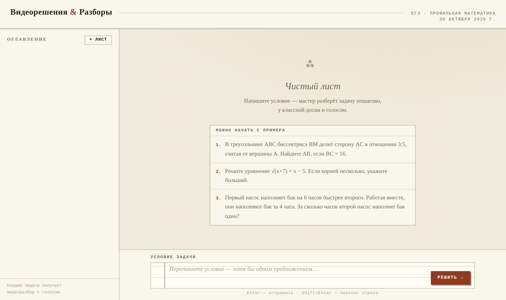

# Видеорешения ЕГЭ — профильная математика

Ученик пишет условие задачи, а приложение возвращает **видеоразбор с голосом**, как у репетитора у доски: пошаговое решение на доске с чертежами и выкладками и озвучку каждого шага. Видео проигрывается прямо в чате и скачивается файлом MP4.



## Что внутри

- **Языковая модель отвечает только за содержание.** Модель (Gemma ~26B через OpenAI-совместимый API) заполняет готовый шаблон: SVG-доску из 6–8 шагов и текст озвучки к каждому. JS-плеер собирается на сервере, поэтому ошибка в ответе модели не ломает воспроизведение.
- **Строгая проверка ответа.** Число шагов на доске должно совпадать с числом реплик, JSON озвучки — быть валидным, файл — завершённым. При ошибке модель получает список ошибок и пробует ещё раз, до трёх попыток; обрезанный ответ восстанавливается.
- **Настоящее видео.** Каждый шаг озвучивается отдельно (edge-tts), длительности замеряются ffprobe, headless-Chromium (Playwright) переключает шаги и снимает кадры, ffmpeg склеивает MP4 1440×810 с голосом.
- **Надёжность.** Генерация идёт в фоне с отображением текущего этапа; зависший поток от провайдера обрывается через 90 секунд тишины; после перезапуска сервера незавершённые задачи помечаются ошибкой.
- **Чаты-«листы»** с историей задач, хранение в SQLite.

## Запуск

```bash
cp .env.example .env   # вписать LLM_BASE_URL, LLM_API_KEY, LLM_MODEL
docker compose up --build -d
# открыть http://localhost:8000
```

Локально без Docker нужны: Python 3.11+, `ffmpeg` в PATH и Chromium для
Playwright (`playwright install chromium`).

## Как это работает

1. `POST /api/generate` — задача уходит в фон.
2. LLM генерирует HTML доски (SVG-группы по шагам + JSON-наррация).
   Ответ строго валидируется; при ошибке — до 3 попыток с обратной связью.
   JS-плеер собирается на сервере, поэтому код модели на него не влияет.
3. Каждый шаг озвучивается edge-tts отдельно, длительности замеряются ffprobe.
4. Playwright переключает шаги и снимает кадры; ffmpeg склеивает кадры
   с аудиодорожкой → `data/media/<id>.mp4`.

## API

- `POST /api/generate` `{"problem": "...", "chat_id": null}` → `{"id", "chat_id"}`
- `GET /api/chats` / `POST /api/chats` / `GET /api/chats/{id}` — чаты («листы»)
- `GET /api/videos/{id}` — статус и текущий этап (`pending|ready|error`, `stage`)
- `GET /api/videos/{id}/html` — интерактивная доска (автопроигрывание)
- `GET /api/videos/{id}/video` — готовый MP4 с голосом
- `GET /api/videos/{id}/mp3` — только озвучка

## Хранение

Всё в SQLite (`data/app.db`, WAL): чаты, элементы ленты, метаданные видео.
Медиафайлы — `data/media/`. Старые JSON-перекладки из `data/*.json`
больше не используются.

## Автор

Сайфуллин Рустам Амирович — Институт искусственного интеллекта, робототехники и системной инженерии КФУ; репетитор по математике.
